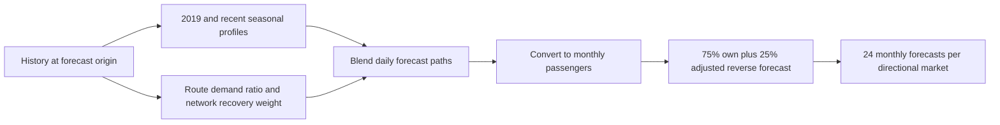

# Adaptive Route-Recovery Forecasting

**An interpretable statistical model that forecasts monthly passenger demand for
each directional airport market, 24 months ahead.**

The selected model combines a route's 2019 seasonal profile with its latest
observed seasonal profile, adjusts demand levels using recent history, and borrows
information from the reverse direction. No neural-network checkpoint, trained
weights, external API, revenue data or GPU is required.

On the supplied project data, the audited July 2024 forecast achieves **17.34%
overall WAPE** across **17,119 directional markets and 410,856 route-months**.
These are separate route-level predictions. The headline is a volume-weighted
summary of their errors, not an error score for every route.

> **Evidence boundary:** These results reproduce a historical project test window
> that was previously inspected during development. They are not a pristine blind
> test or proof of statistical significance. Development folds select parameters
> and are not independent nested cross-validation. See [model card](docs/MODEL_CARD.md).

**Navigation:** [Quick start](#quick-start) · [Selection](#reproduce-parameter-selection) ·
[Evaluation](#evaluate-frozen-settings-on-the-final-window) ·
[Results](#published-settings-and-results) · [Mathematics](#mathematical-specification-of-the-final-model) ·
[Verification](#verification-and-information-boundaries) · [Repository map](#repository-map)



## Quick start

Use Python **3.11 or newer**. Run commands from this repository's root.
These commands work in PowerShell as well as a typical Unix shell.

```sh
python -m venv .venv
```

Activate on Windows PowerShell:

```powershell
.\.venv\Scripts\Activate.ps1
```

Or on macOS/Linux:

```sh
source .venv/bin/activate
```

Install and run the self-contained tests:

```sh
python -m pip install -e ".[plots]"
python -m unittest discover -s tests -v
```

The package has no dependency on another project directory. The examples below
use `data/pax_forecasting.csv`; obtain the authorized project input and place it
there, or substitute an absolute path. Raw project data is **not included**.
See [input contract](data/README.md). The final model reads only airport codes,
year/month and OD_PAX from a pipe-delimited CSV.

### Generate a forecast without evaluating future demand

```sh
python scripts/forecast.py --data data/pax_forecasting.csv --origin 2024-07 --config configs/final.json --output outputs/forecast
```

This command needs history through the origin only. It writes `predictions.csv`
with `ORG_AIRPRT`, `DES_AIRPRT`, `month`, `horizon`, `y_pred`, and a `run.json`
recording input SHA256, parameters and software versions. It never builds labels.
The file can contain future rows; they cannot enter the model's history or route
universe. Raw bytes may be hashed for provenance, which is not a forecast feature.

### Reproduce parameter selection

```sh
python scripts/tune_parameters.py --data data/pax_forecasting.csv --output outputs/development
```

This runs the original **198 configurations** on **three chronological origins**,
then minimizes the arithmetic mean of the three fold WAPEs. It saves:

- `development_losses.csv`: all **594** configuration/fold scores.
- `ranked_configurations.csv`: 198 mean development WAPEs.
- `selected_config.json`: frozen winning settings, consumable by forecast/evaluation.
- `leakage_checks.json` and `run.json`: causal checks and run provenance.

The code truncates the search input at **July 2024 before building any fold**.
All development target months end on or before that cutoff.

| Origin | Target months | Horizon |
|---|---|---|
| July 2021 | Aug 2021–Jul 2023 | 24 months |
| January 2022 | Feb 2022–Jan 2024 | 24 months |
| July 2022 | Aug 2022–Jul 2024 | 24 months |

| Family | Window | Recent weight | Recovery parameter | Reverse pool | Settings |
|---|---|---|---|---|---:|
| Route recovery | 1, 2, 3, 6 | .35, .70, 1.00 | damping: 2, 6, 12, 24 months | 0, .25, .50 | 144 |
| Network recovery | 3, 6, 9 | .35, .70, 1.00 | uplift coefficient: .5, 1.0 | 0, .25, .50 | 54 |

The alternative network-recovery family is included **only to reproduce the
original search**. It does not enter the selected final forecast. Its recovery
parameter is an uplift coefficient, unlike route recovery's damping time.

### Evaluate frozen settings on the final window

```sh
python scripts/evaluate_test.py --data data/pax_forecasting.csv --config configs/final.json --origin 2024-07 --output outputs/evaluation
```

To evaluate the settings just selected in your own search, replace `--config`
with `outputs/development/selected_config.json`. Evaluation does not tune anything.
It generates the forecast from history first, then constructs labels separately
for **August 2024–July 2026**, scoring only the historically known market universe.
It saves `metrics.json`, `predictions.csv` (now including `y_true`),
`route_metrics.csv`, `leakage_checks.json` and `run.json`.
All output directories must be new, protecting prior runs from accidental replacement.

The 17- and 21-month summaries are overlapping subsets of this one forecast,
not separate forecasts or independent tests. Year-one and year-two scores are
also saved. The baseline repeats the latest 12 **monthly passenger totals** twice,
matching the original baseline, rather than applying daily normalization to it.

### Full workflow in one command

```sh
python scripts/reproduce.py --data data/pax_forecasting.csv --output outputs/reproduction
```

This selects on development folds, saves those settings, and evaluates them
without allowing final labels into the selection loop.

### Try it without access to project data

```sh
python scripts/make_demo_data.py
python scripts/forecast.py --data data/demo.csv --output outputs/demo_forecast
```

This generates a small, explicitly **synthetic** dataset for trying the interface.
Its scores do not reproduce or substantiate the project results.

### Plot a directional route

```sh
python -m route_recovery plot --predictions outputs/evaluation/predictions.csv --origin-airport IAH --destination-airport LAX --output outputs/iah_lax.png
```

The basic Matplotlib chart contains monthly actuals and forecasts. For a prediction
file without labels, it draws only forecasts. The `[plots]` extra is optional.

To generate the four model-building illustrations for one route:

```sh
python scripts/plot_model_steps.py --data data/pax_forecasting.csv --origin SLC --destination LHR --output outputs/slc_lhr_steps --no-show
```

This writes four PNGs, the 24 monthly forecasts and a calculation-details JSON.
The first three figures share a daily-passenger scale. The fourth demonstrates
the monthly conversion and reverse pooling using December 2024. It uses only
history through July 2024 and the published settings. SLC→LHR illustrates a
visible historical demand-level change, not a claim of best held-out accuracy.

To compare a completed run with the included audited benchmark:

```sh
python scripts/check_reproduction.py --development outputs/development --evaluation outputs/evaluation
```

This checks the input hash, winning settings, fold WAPEs and every reported metric
in all three final-window summaries. A different dataset should not match these
reference scores and is rejected by the reference checker, not by forecasting.

## Published settings and results

```json
{"family":"route recovery","window":3,"recent":0.7,"recovery":12.0,"pool":0.25}
```

| Evaluation window | WAPE | RMSE (PAX) | sMAPE | RMSLE | Volume bias |
|---|---:|---:|---:|---:|---:|
| Aug 2024–Dec 2025 (17 months) | 14.73% | 1,189.40 | 0.2737 | 0.4405 | +1.81% |
| Aug 2024–Apr 2026 (21 months) | 15.77% | 1,249.47 | 0.2867 | 0.4642 | +3.00% |
| **Aug 2024–Jul 2026 (24 months)** | **17.34%** | **1,408.51** | **0.2970** | **0.4847** | **+4.77%** |

The full-window seasonal-repeat baseline achieves **18.29% WAPE**, making the
model's historical relative error reduction approximately **5.16%**. WAPE is an
error metric; it must not be restated as "82.66% accuracy."

- Year-one WAPE: **13.89%**; year-two WAPE: **21.02%**.
- Median per-route 24-month WAPE: **24.15%**. Middle 50%: **16.70–35.91%**.
- IAH→LAX 24-month WAPE: **10.00%**, an illustrative route, not the network average.
- Mean tuned development WAPE: **19.08%**, with Fold 3 **17.07%**.

The fixed July 2024 forecast repeats the same annual seasonal passenger profile
in year two. The actual second-year decline is not anticipated, contributing to
the increasing bias. There is no rolling update using first-year test observations.

Aggregate audited reference metrics are under `reports/reference/`; locally
reproduced verification is under `reports/reproduction/` once generated for this
release. Raw observations and route-level output files remain gitignored.

## Mathematical specification of the final model

### Notation and historical information

Let $i=(a,b)$ be a directional route, $\bar i=(b,a)$ its reverse, $t_0$ the
last observed month, and $h=1,\ldots,24$ a future horizon. Let $m(h)$ be the target
calendar month and $D_h$ its known number of calendar days. Passenger counts can
be fractional in the supplied extract; the code does not round forecasts.

Observed monthly PAX $y_{i,t}$ becomes the daily rate

$$d_{i,t}=y_{i,t}/D_t.$$

For every calendar month $m$, $b_{i,m}$ is its **2019 daily rate**, and
$\ell_{i,m}$ is the daily rate for that month in the **latest 12 observed months**.
The latest profile is reordered January–December. It is not a calendar-year
average and is not a 12-month moving-average curve.

### 1. Route demand ratio and network regime

For the selected window $w=3$, let $C$ contain the latest three observed calendar
months (May–July 2024 at the final origin). Define

$$O_i=\sum_{t\in C}d_{i,t},\qquad E_i=\sum_{t\in C}b_{i,m(t)},$$
$$r_i=\mathrm{clip}\left(\frac{O_i+2}{E_i+2},0.05,8\right).$$

This is one ratio per route, computed from **sums of monthly daily rates**. It is
neither a mean of monthly ratios nor a comparison of all 12 months. The fixed
add-2 smoothing limits thin-route instability. It is not a fitted Laplace model.

The pooled network comparison and shared recovery weight are

$$R=\frac{\sum_i O_i}{\sum_i E_i},\qquad
g=\mathrm{clip}\left(\frac{1.06-R}{0.20},0,1\right).$$

The network ratio has **no add-2 smoothing**. It pools traffic rather than giving
equal weight to each route ratio. The recovery weight is 1 at or below 86% of 2019,
declines linearly to 0 at 106%, and remains 0 above that level. These thresholds
are fixed design constants, not parameters in the 198-setting grid.

### 2. Two daily forecast paths

With selected damping $\tau=12$ months,

$$p_h=g(1-e^{-h/\tau}),\qquad L_{i,h}=(1-p_h)r_i+p_h,$$
$$B_{i,h}=b_{i,m(h)}L_{i,h}.$$

The ratio moves partway toward 1, the 2019 level. Adjustment occurs faster at
first and then slows. **$g$ controls its extent; $\tau$ controls its time scale.**
When $g<1$, even its infinite-horizon limit need not equal 1.

The recent path is

$$F_i=\mathrm{clip}\left(\frac{O_i+2}{\sum_{t\in C}\ell_{i,m(t)}+2},0.5,2\right),
\qquad A_{i,h}=\ell_{i,m(h)}F_i.$$

In this implementation the window is contained in the latest observed year,
so numerator and denominator use the same observations: **$F_i=1$**. This path
repeats recent seasonality; it adds no independent momentum extrapolation.

### 3. Route-aware seasonal blending and monthly conversion

With selected recent weight $\rho=0.70$, define recent-season trust and
structural share:

$$v=\rho(1-g),\qquad
s_i=\min\left(1,\frac{\mathrm{mean}_{m}(b_{i,m})}
{\max[0.25\mathrm{mean}_{m}(\ell_{i,m}),0.1]}\right),$$
$$q_i=(1-v)s_i,\qquad
\widehat y^{\rm own}_{i,h}=D_h[q_iB_{i,h}+(1-q_i)A_{i,h}].$$

Means are over the 12 calendar-month daily rates. Established routes typically
have $s_i=1$. Routes with little or no 2019 traffic get less 2019 weight and more
recent-profile weight. The floor 0.1 stabilizes near-zero denominators.

At July 2024, $R=1.0823564859$, so $g=0$. Therefore $L_{i,h}=r_i$ and
$q_i=0.30s_i$: established routes use **30% scaled 2019 + 70% recent seasonality**.

### 4. Historical directional adjustment

Let $T_i$ be route $i$'s trailing-12-month **raw monthly passenger total**. Let
$P^{19}_{i,m}$ and $P^{last}_{i,m}$ be same-calendar-month **raw counts** in 2019
and the latest observed year. These inputs are counts, unlike the daily-rate
profiles in the preceding steps. Define

$$a_i=\frac{T_i+100}{T_{\bar i}+100},\qquad
u^k_{i,m}=\frac{P^k_{i,m}+100a_i}{P^k_{\bar i,m}+100},\quad k\in\{19,last\}.$$

The fixed 100-passenger smoothing pulls thin monthly directional ratios toward
the smoothed annual directional ratio. It is not a fitted empirical-Bayes prior.

$$M_{i,h}=\mathrm{clip}\left(\sqrt{u^{19}_{i,m(h)}u^{last}_{i,m(h)}},0.25,4\right),$$
$$\widehat y^{\rm reverse}_{i,h}=M_{i,h}\widehat y^{\rm own}_{\bar i,h},$$
$$\boxed{\widehat y_{i,h}=0.75\widehat y^{\rm own}_{i,h}
+0.25\widehat y^{\rm reverse}_{i,h}}.$$

If the reverse market was not known at the origin, the final forecast equals
the own-route forecast. The reverse input is another **forecast**, never the
reverse route's future actual demand. These are origin–destination markets, not
necessarily nonstop flights or flight segments.

### Worked example: IAH→LAX, December 2024

| Quantity | Value |
|---|---:|
| Route ratio $r_i$ | 1.0664976 |
| December 2019 daily rate | 1,279.2026 |
| Latest December daily rate | 1,203.0813 |
| Own-route monthly forecast | 38,794.5425 |
| Reverse own-route forecast | 40,280.0632 |
| Historical direction multiplier | 0.9860659 |
| Adjusted reverse forecast | 39,718.7956 |
| **Final = 75% own + 25% adjusted reverse** | **39,025.6058** |

## Metric definitions

For all scored route-month observations $j$:

$$\mathrm{WAPE}=\frac{\sum_j|y_j-\hat y_j|}{\sum_j y_j},\quad
\mathrm{Bias}=\frac{\sum_j(\hat y_j-y_j)}{\sum_j y_j},$$
$$\mathrm{MAE}=\mathrm{mean}|y-\hat y|,\quad
\mathrm{RMSE}=\sqrt{\mathrm{mean}(y-\hat y)^2},$$
$$\mathrm{sMAPE}=\mathrm{mean}\frac{2|y-\hat y|}{|y|+|\hat y|},\quad
\mathrm{RMSLE}=\sqrt{\mathrm{mean}[\log(1+\hat y)-\log(1+y)]^2}.$$

Both-zero sMAPE terms are zero. WAPE and bias are `null` when actual volume is
zero, rather than JSON NaN. All nonzero-target definitions match the shared
project evaluator. Ratios in JSON are fractions: `0.1734` means 17.34%. MAE/RMSE
are in passenger-volume units. Median route WAPE is an **unweighted** median of
24-month route WAPEs, excluding zero-total-target routes. Network WAPE is neither
that median nor the error after cancelling positive/negative route errors.

## Verification and information boundaries

```sh
python scripts/check_leakage.py --data data/pax_forecasting.csv --output outputs/causality
```

The verifier applies nine adversarial mutations at four origins (**36 checks**),
plus four positive controls that change history. It tests huge/zero/random,
missing/negative/infinite future demand, removal of future rows, addition of a
future-only reverse market, and row reordering. Forecasts must be exactly equal.
Synthetic tests run the suite for both searched families and separately verify
that all **594** development losses and selected settings ignore final targets.

The original full-file pivot could expose future-only reverse-route membership.
This package fixes that by **filtering before pivoting**. All 17,119 markets in
the supplied dataset were already historical at the evaluated origins, so this
fix preserves the reproduced scores. Input validation is also history-scoped;
invalid future passenger values cannot block an otherwise valid forecast.

This fixes implementation lookahead; it cannot undo earlier human inspection of
the test window. Freeze the code/configuration and evaluate genuinely fresh data
before making stronger deployment or generalization claims.

## Repository map

```text
configs/final.json            Frozen published settings
src/route_recovery/
  data.py                    History-only routes, separate future labels, CSV output
  model.py                   Statistical equations and forecast API
  search.py                  Original two-family, 198-configuration selection
  metrics.py                 Canonical primary/supporting metrics
  verification.py            Adversarial future-information checks
  cli.py                     Command-line interface and provenance
scripts/                     Separate runnable selection/forecast/test/demo programs
tests/test_model.py           Synthetic leakage, selection, calendar and metric tests
reports/reference/           Original audited aggregate scores
reports/reproduction/        Aggregate results verified for this package
docs/MODEL_CARD.md            Intended use, limitations and evidence boundaries
docs/PROVENANCE.md            Original implementation credit and changes
data/                        Private input directory, ignored by Git
outputs/                     Local run artifacts, ignored by Git
```

## Intended use and limitations

Use these forecasts as an explainable baseline for market-demand review and
seasonal planning analysis. Capacity, itinerary availability, yield and operating
costs require separate decision models. The model supplies no prediction intervals,
causal demand-driver estimates, capacity constraints or optimized schedules.
Small markets remain volatile, and a fixed 2019 anchor can become stale. New
future-only markets are excluded unless a legitimate as-of market universe is
defined in a future extension. A complete 2019 reference is a current requirement.

The source implementation belongs to the project collaborators. This repository
does not assert a new open-source license or permission to redistribute project
data. Attribution and source hashes are recorded in [provenance](docs/PROVENANCE.md).
